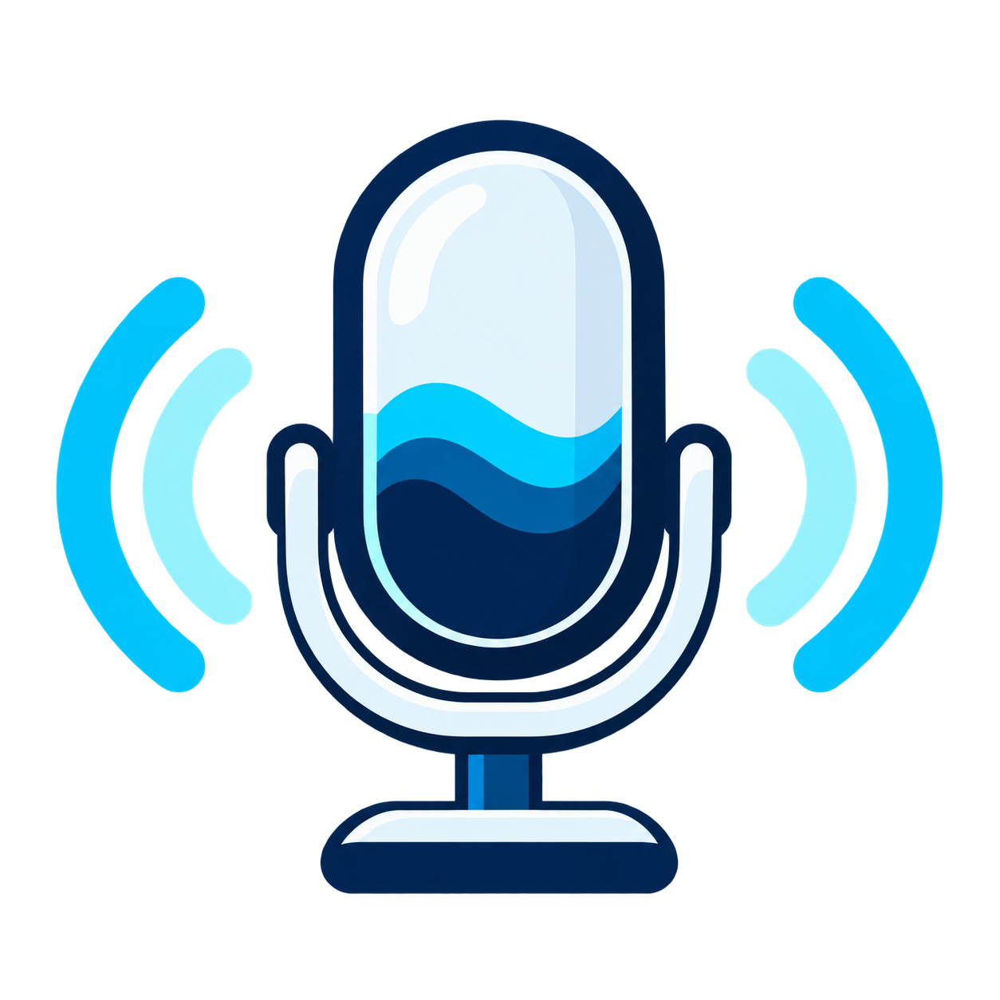

<p align="center">
  
</p>

<h1 align="center">Kynn Voice</h1>

<p align="center">
  Redução local de ruído para o microfone no Windows.
</p>

<p align="center">
  <a href="https://github.com/kynn-dev/kynn-voice/releases/tag/v0.1.5">
    
  </a>
  <a href="LICENSE">
    
  </a>
  
</p>

<p align="center">
  <a href="https://github.com/kynn-dev/kynn-voice/releases/download/v0.1.5/KynnVoice-Setup-0.1.5-x64.exe"><strong>Baixar Setup</strong></a>
  ·
  <a href="https://github.com/kynn-dev/kynn-voice/releases/download/v0.1.5/KynnVoice-0.1.5-windows-x64-portable.zip">ZIP portátil</a>
  ·
  <a href="https://github.com/kynn-dev/kynn-voice/releases/download/v0.1.5/KynnVoice-0.1.5-windows-x64.exe">EXE avulso</a>
  ·
  <a href="https://github.com/kynn-dev/kynn-voice/releases/tag/v0.1.5">Ver release e notas</a>
</p>

Fork do projeto [danjaniell/noise-gator](https://github.com/danjaniell/noise-gator), distribuído sob MIT, o Kynn Voice captura o microfone, reduz ruídos no processador do computador e envia o áudio tratado ao VB-CABLE para uso em chamadas, jogos e gravações. A versão 0.1.5 oferece um Setup que instala o aplicativo e, somente após uma escolha explícita, abre o instalador oficial do VB-CABLE com UAC. O ZIP portátil e o EXE avulso continuam sendo distribuições somente do aplicativo.

**[Começar](#começar) · [Modos](#três-modos-de-processamento) · [Preferências](#preferências-e-logs) · [Build](#build-e-testes) · [Créditos](#créditos-e-licença)**

> [!NOTE]
> Esta é uma pré-release para Windows x64 com processamento em CPU. Os resultados reais e testes pendentes estão nos [relatórios da fase 1](STARTUP_PERSISTENCE_REPORT.md) e de [estabilidade](STABILITY_REPORT.md). O app e o Setup não têm assinatura Authenticode própria; os hashes publicados ajudam a conferir integridade.

## Como o áudio é roteado

```text
Microfone USB ──► Kynn Voice ──► CABLE Input
Soundboard ────────────────────► CABLE Input
                                CABLE Output ──► microfone no Discord, jogo ou gravador
```

Selecione **CABLE Output (VB-Audio Virtual Cable)** como microfone no outro aplicativo. Para incluir uma soundboard, configure-a para tocar diretamente em **CABLE Input**. Assim os efeitos não passam pela captura nem pelo processamento do microfone.

## Três modos de processamento

| Modo | Processamento |
| --- | --- |
| **Leve** | RNNoise por meio da implementação Rust <code>nnnoiseless</code>; uma passagem e sem baixar modelos. |
| **Equilibrado** | DeepFilterNet 3 com Microsoft ONNX Runtime em CPU. |
| **Estúdio** | DeepFilterNet 3 e controles vocais, incluindo gate, equalização e normalização automática. |

Equilibrado e Estúdio baixam os arquivos fixados do modelo e do runtime na primeira utilização. Os downloads são verificados por SHA-256; depois de baixados, a inferência acontece localmente. O controle **Supressão ligada** pode ser desmarcado para comparar o sinal processado com o bypass.

Um único supressor neural é usado por vez. O bypass mantém o estado do modelo avançando entre frames. Não há envio do áudio para um serviço em nuvem.

## Começar

1. Para uma instalação guiada, baixe o [Setup da versão 0.1.5](https://github.com/kynn-dev/kynn-voice/releases/download/v0.1.5/KynnVoice-Setup-0.1.5-x64.exe). O Setup valida os hashes incorporados e mostra três escolhas: **App + VB-CABLE**, **Somente o app** ou **Cancelar**. A primeira extrai o arquivo original da VB-Audio e só inicia o instalador do driver depois que você confirma a solicitação UAC; a instalação deve ser seguida de reinicialização do Windows conforme orientação do fabricante. A segunda instala apenas o Kynn Voice.
2. Se preferir não instalar nada no sistema, baixe o [ZIP portátil 0.1.5](https://github.com/kynn-dev/kynn-voice/releases/download/v0.1.5/KynnVoice-0.1.5-windows-x64-portable.zip), extraia numa pasta permanente e abra `kynn-voice.exe`. Esse ZIP não inclui nem instala o driver. O [EXE avulso](https://github.com/kynn-dev/kynn-voice/releases/download/v0.1.5/KynnVoice-0.1.5-windows-x64.exe) tem o mesmo comportamento portátil.
3. Se o VB-CABLE já estiver instalado, escolha **Somente o app** no Setup ou use o ZIP portátil. Para instalar o driver depois, use o [site oficial da VB-Audio](https://vb-audio.com/Cable/).
4. Abra **Configurações** na bandeja do Kynn Voice. Escolha o microfone USB ou o dispositivo de entrada padrão do Windows e clique em **Aplicar dispositivos**.
5. No Discord, jogo ou gravador, escolha **CABLE Output (VB-Audio Virtual Cable)** como microfone.
6. Se usar uma soundboard, selecione **CABLE Input** como saída dela.

O Setup não altera o dispositivo de áudio padrão do Windows. O aviso [VB-CABLE-NOTICE.txt](packaging/VB-CABLE-NOTICE.txt) identifica a origem do driver, o caráter donationware e os termos do fabricante. O arquivo ZIP portátil contém somente o aplicativo e os avisos do projeto.

## Preferências e logs

As preferências são salvas automaticamente em <code>%APPDATA%\noise-gator\config.toml</code>. A opção **Iniciar com o Windows** fica nas configurações, vem desativada e grava a inicialização somente para o usuário atual. Habilite-a depois de colocar o executável na pasta em que pretende mantê-lo.

O log do aplicativo fica em <code>%LOCALAPPDATA%\Kynn Voice\logs\kynn-voice.log</code>.

Modo, redução/bypass, ganhos, gate, EQ/clareza, autogain e dispositivos aplicados são restaurados ao reabrir. O estado pausado também é preservado. O salvamento usa thread própria e substituição do arquivo completo, com a versão válida anterior em `config.previous.toml`. Encerrar à força pode perder escolhas feitas antes do último salvamento concluído.

## Por dentro do app

```text
WASAPI → conversão/downmix → resampling → mono 48 kHz / frames de 10 ms
       → RNNoise ou DeepFilterNet → DSP vocal conforme modo/controles
       → fila de saída → CABLE Input
```

As callbacks fazem a transferência de áudio por buffers limitados. Inferência, carregamento de modelos, acesso a arquivos, cadastro de inicialização e reconfiguração de dispositivos ficam fora delas. A janela usa controles nativos do Windows, sem criar contexto OpenGL ao abrir as configurações.

CPU/memória, duração de processamento, latência de software e contadores de underruns/drops aparecem na interface e no log. O processo usa cota de 15% da capacidade total de CPU por ciclos de escalonamento e limite de 512 MiB de memória privada; veja os detalhes e limites dessas proteções em [STABILITY_REPORT.md](STABILITY_REPORT.md). Latência de software não equivale à latência física ponta a ponta.

## Build e testes

Para reproduzir as verificações, use Windows x64 com Rust stable e o target MSVC x64 (<code>x86_64-pc-windows-msvc</code>), Visual Studio Build Tools com ferramentas C++ x64 e Windows SDK. A validação local e a CI usam Rust **1.99.0**.

```powershell
cargo fmt --all --check
cargo check --all-targets --locked
cargo test --locked
cargo check --all-targets --no-default-features --locked
cargo test --no-default-features --locked
# Teste opt-in; exige os assets DeepFilterNet e ONNX Runtime disponíveis
cargo test --locked --features deepfilter deepfilter_keeps_streaming_state_between_frames -- --ignored
cargo build --release --locked --target x86_64-pc-windows-msvc
```

Na validação da versão 0.1.4, as duas execuções de testes registraram 38 testes aprovados cada; os testes opt-in de ONNX e do registro de inicialização também passaram quando executados separadamente. A janela nativa passou por 50 ciclos de abertura e fechamento. Testes pela interface confirmaram o salvamento automático, a restauração após encerramento forçado e a inclusão e remoção da opção de inicialização. A preparação do Setup 0.1.5 não é uma validação de instalação real do driver.

O teste de áudio usou um microfone USB e VB-CABLE em um host Windows 11 x64 com Ryzen 7 9700X e 32 GB de RAM: 20 segundos por modo, sem underruns ou drops nessa medição. Isso não comprova compatibilidade geral, qualidade perceptiva ou latência de ponta a ponta. Novo logon real do Windows, sessão com League of Legends, reconexão física do USB, uso prolongado e teste auditivo da soundboard com chamada/jogo ainda não foram validados.

Para gerar o pacote portátil a partir de um executável compilado:

```powershell
.\packaging\build-portable.ps1 -AppPath .\target\x86_64-pc-windows-msvc\release\kynn-voice.exe
```

O script empacota somente app, instruções e licenças e gera `SHA256SUMS.txt`. Ele não instala nem inclui o driver virtual.

Para preparar o Setup Windows, obtenha o arquivo original do [VB-CABLE](https://download.vb-audio.com/Download_CABLE/VBCABLE_Driver_Pack45.zip), confira o SHA-256 publicado no [aviso de distribuição](packaging/VB-CABLE-NOTICE.txt) e execute o script com o executável já compilado:

```powershell
.\packaging\build-installer.ps1 `
  -DriverArchivePath .\VBCABLE_Driver_Pack45.zip `
  -AppPath .\target\x86_64-pc-windows-msvc\release\kynn-voice.exe `
  -SkipCargoBuild
```

O resultado é `KynnVoice-Setup-0.1.5-x64.exe` e seu arquivo `.sha256`. O Setup incorpora o arquivo original sem alteração, mas o instalador do driver só é executado depois da escolha **App + VB-CABLE** e da confirmação UAC. O Setup não tem assinatura Authenticode própria; o hash publicado permite conferir integridade e não substitui uma assinatura.

## Créditos e licença

O arquivo [LICENSE](LICENSE) preserva o aviso de copyright do projeto original.

Créditos técnicos dos componentes de processamento:

- [RNNoise](https://github.com/xiph/rnnoise) e sua implementação Rust [nnnoiseless](https://crates.io/crates/nnnoiseless).
- [DeepFilterNet](https://github.com/Rikorose/DeepFilterNet).
- [Microsoft ONNX Runtime](https://github.com/microsoft/onnxruntime).

Veja [THIRD_PARTY_NOTICES.md](THIRD_PARTY_NOTICES.md) e [THIRD_PARTY_LICENSES.txt](THIRD_PARTY_LICENSES.txt) para atribuições e textos de licença. A licença MIT do fork cobre o código do aplicativo; componentes e assets mantêm suas licenças próprias. O Setup inclui o VB-CABLE Driver Pack 45 original da VB-Audio para conveniência, preserva sua identificação e o aviso donationware, e pode abrir o instalador oficial somente após a escolha do usuário. VB-CABLE continua sendo um produto da VB-Audio, separado da marca Kynn Voice.

O Setup e o ZIP portátil incluem `LICENSE`, `THIRD_PARTY_NOTICES.md` e `THIRD_PARTY_LICENSES.txt`; na pasta de instalação, o Setup grava a licença como `KynnVoice-LICENSE.txt` e mantém os nomes originais dos dois documentos de terceiros. O Setup também incorpora o aviso de distribuição do VB-CABLE e valida os hashes dos textos de terceiros antes de apresentar as opções.
